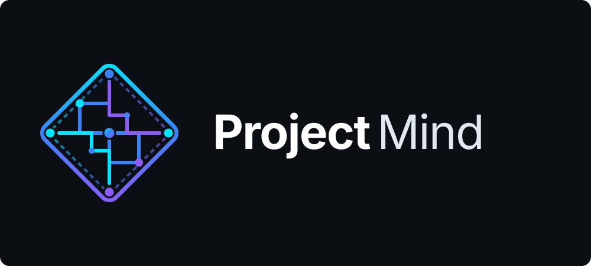
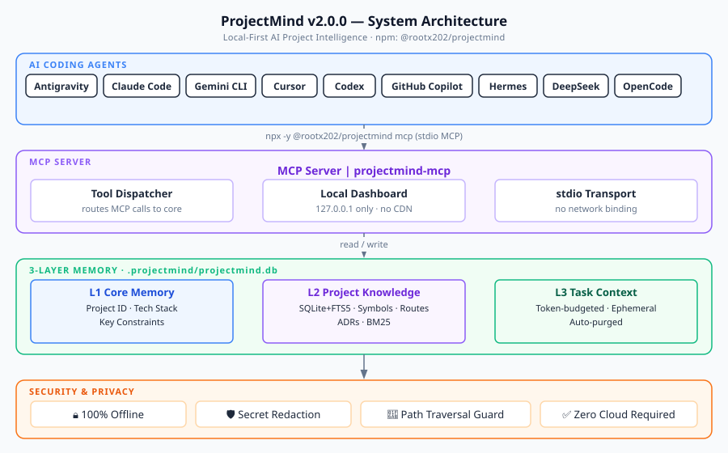
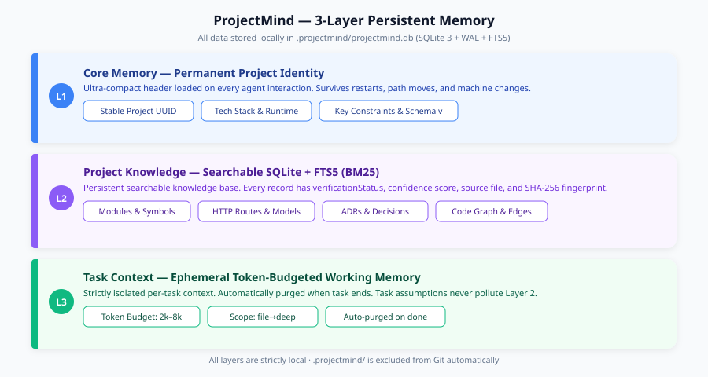
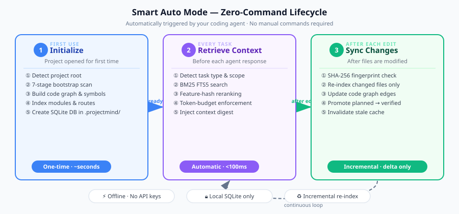
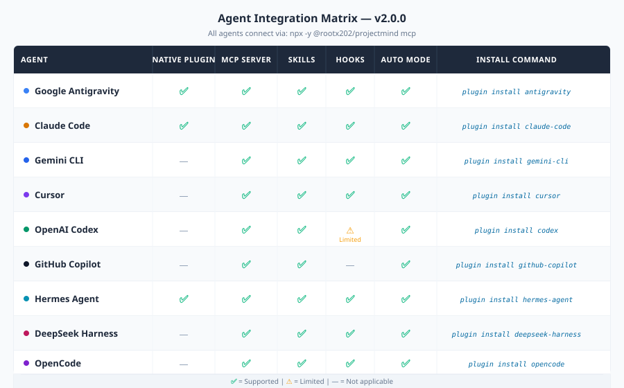
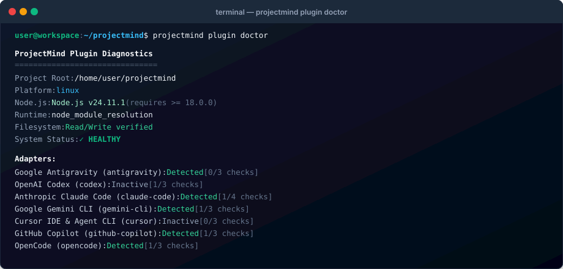
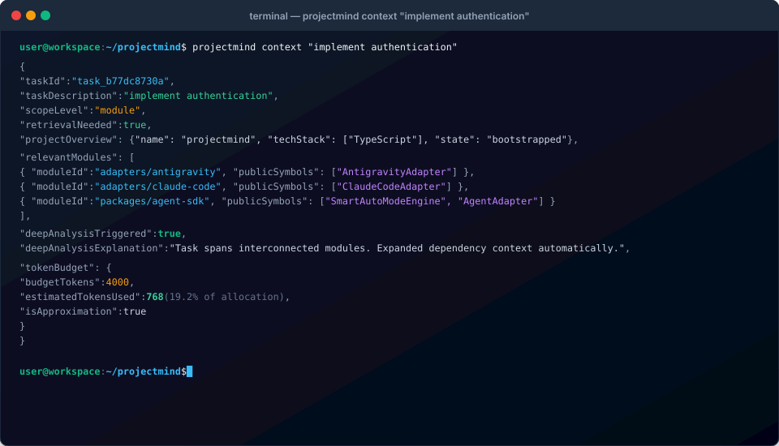
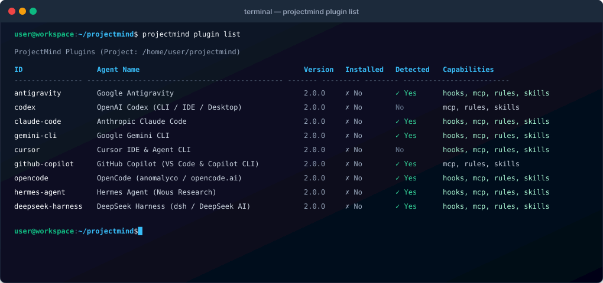
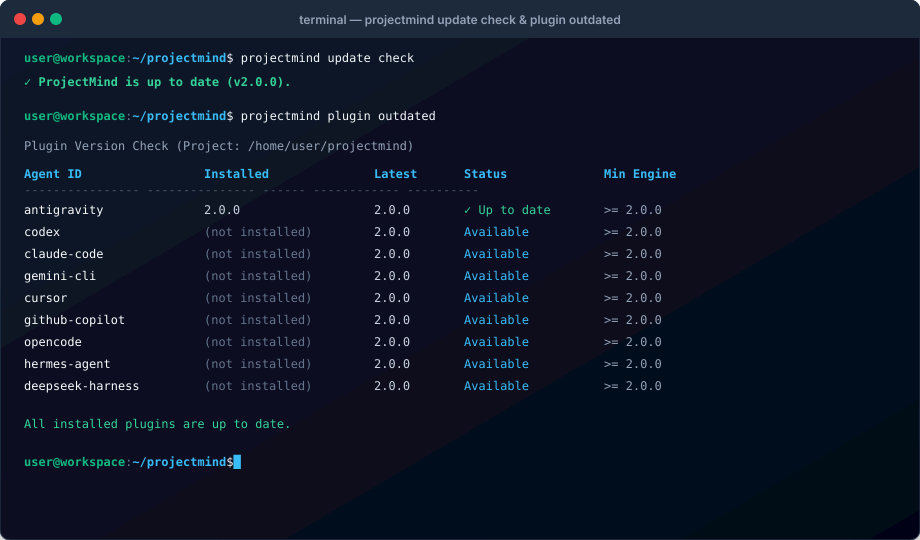

<p align="center">
  
</p>

<h1 align="center">ProjectMind</h1>

<p align="center">
  <strong>Universal Local-First AI Project Intelligence & Persistent Context Engine</strong><br/>
  Gives your coding agent a persistent memory, offline code intelligence, and a local dashboard — with zero cloud accounts required.
</p>

<p align="center">
  <a href="https://www.npmjs.com/package/@rootx202/projectmind"></a>
  <a href="LICENSE"></a>
  <a href="https://github.com/Rootx202/ProjectMind/issues"></a>
  = 18"/>
  
</p>

---

## What is ProjectMind?

ProjectMind is **not** a coding agent or chatbot. It is a local intelligence and persistent memory layer that plugs directly into your existing coding agents:

- 🤖 **Google Antigravity**
- 🤖 **Anthropic Claude Code**
- 🤖 **Google Gemini CLI**
- 🤖 **OpenAI Codex**
- 🤖 **Cursor**
- 🤖 **GitHub Copilot (VS Code)**
- 🤖 **Hermes Agent**
- 🤖 **DeepSeek Harness**
- 🤖 **OpenCode**

Once installed, your agent automatically remembers your project, retrieves the right context before every task, and syncs changes — all offline, all local.

---

## System Architecture

<p align="center">
  
</p>

---

## 3-Layer Memory Model

<p align="center">
  
</p>

| Layer | Name | What it stores |
|-------|------|---------------|
| **1** | Core Memory | Project identity, tech stack, key constraints — permanent |
| **2** | Project Knowledge | SQLite + FTS5 searchable knowledge, code graph, symbols, routes, models, ADRs |
| **3** | Task Context | Temporary, token-budgeted retrieval state per task |

---

## Smart Auto Workflow

<p align="center">
  
</p>

Once installed into your agent, ProjectMind runs fully automatically:
1. **On first use** → initializes project memory (7-stage bootstrap)
2. **Before each task** → retrieves scoped context
3. **After each edit** → syncs changed files incrementally

---

## Installation

> **Requires Node.js ≥ 18**

---

### 🤖 Let Your Agent Do It (Recommended)

Just paste this prompt into your AI coding agent — it will detect itself, install ProjectMind globally, and verify everything automatically:

```
Set up ProjectMind so it works automatically in ALL my projects.

Steps:
1. Run: npm install -g @rootx202/projectmind
2. Detect which coding agent you are (antigravity / claude-code / gemini-cli / cursor / codex / github-copilot / hermes-agent / deepseek-harness / opencode)
3. Run: projectmind plugin install <your-agent-name> --scope global --yes
4. Run: projectmind doctor
5. Tell me which config files were updated and confirm everything is working.
```

> **Global scope** configures ProjectMind at the user level — it activates automatically in every project you open, with zero per-project setup.

---

### Manual Install (Global — works in all projects)

**Step 1:** Install globally

```bash
npm install -g @rootx202/projectmind
```

**Step 2:** Install your agent integration globally

```bash
# Pick your agent:
projectmind plugin install claude-code      --scope global --yes
projectmind plugin install antigravity      --scope global --yes
projectmind plugin install gemini-cli       --scope global --yes
projectmind plugin install cursor           --scope global --yes
projectmind plugin install codex            --scope global --yes
projectmind plugin install github-copilot  --scope global --yes
projectmind plugin install hermes-agent    --scope global --yes
projectmind plugin install deepseek-harness --scope global --yes
projectmind plugin install opencode         --scope global --yes
```

**Step 3:** Verify

```bash
projectmind doctor
```

---

### Manual Install (Per-Project)

If you prefer to install only for a specific project:

```bash
npx -y @rootx202/projectmind plugin install claude-code --yes
```

Or via MCP directly:

```bash
npx -y @rootx202/projectmind mcp
```

---

## Agent Compatibility Matrix

<p align="center">
  
</p>

| Agent | Native Plugin | MCP | Skills | Hooks | Auto Mode |
|-------|:---:|:---:|:---:|:---:|:---:|
| Google Antigravity | ✅ | ✅ | ✅ | ✅ | ✅ |
| Claude Code | ✅ | ✅ | ✅ | ✅ | ✅ |
| Gemini CLI | — | ✅ | ✅ | ✅ | ✅ |
| Cursor | — | ✅ | ✅ | ✅ | ✅ |
| OpenAI Codex | — | ✅ | ✅ | Limited | ✅ |
| GitHub Copilot | — | ✅ | ✅ | — | ✅ |
| Hermes Agent | ✅ | ✅ | ✅ | ✅ | ✅ |
| DeepSeek Harness | — | ✅ | ✅ | ✅ | ✅ |
| OpenCode | — | ✅ | ✅ | ✅ | ✅ |

---

## CLI Commands

After installation, run diagnostics or manage your project memory:

```bash
# Run diagnostics
projectmind doctor

# View current context
projectmind context

# List installed plugins
projectmind plugin list

# Update plugins
projectmind update
```

### CLI Screenshots

| Command | Preview |
|---------|---------|
| `projectmind doctor` |  |
| `projectmind context` |  |
| `projectmind plugin list` |  |
| `projectmind update` |  |

---

## Key Features

- 🧠 **Persistent Memory** — Project knowledge survives agent restarts and new sessions
- 🌳 **AST Code Analysis** — Tree-sitter/WASM for Python, Go, Rust, Java, C, C++, C# + Babel for JS/TS
- 📊 **Local Dashboard** — HTML dashboard at `127.0.0.1` with memory layers, code graph, symbols, search, ADRs, and estimated token savings — zero CDN or external services
- 🔒 **100% Offline & Private** — Zero mandatory cloud accounts, zero paid APIs
- 🚫 **Secret Protection** — Auto-excludes `.env`, `.pem`, `.key`, `.ssh`, tokens
- 🛡️ **Path Traversal Protection** — Symlink escape & prompt-injection sanitization
- ♻️ **Incremental Sync** — Only re-indexes changed files using SHA-256 fingerprints
- 🏗️ **Greenfield + Existing Projects** — Works on new and existing codebases

---

## Local Dashboard

The built-in dashboard runs on `127.0.0.1` only (never exposed to the network):

```bash
projectmind dashboard
```

Shows: memory layers · code graph · symbols · HTTP routes · database models · ADRs · search · events · token savings

---

## Privacy & Security

ProjectMind is designed to be **strictly local-first**:

- ✅ All indexing, retrieval, and writes work **100% offline**
- ✅ SQLite database stored in `<project>/.projectmind/projectmind.db` only
- ✅ Network access **only** for explicit, verified update checks (HTTPS + allowlist)
- ✅ Secrets automatically excluded from indexing
- ✅ `.projectmind/` added to `.gitignore` automatically

---

## Repository Structure

```
ProjectMind/
├── apps/
│   ├── cli/              # Main CLI entry point
│   ├── setup/            # Agent detection & idempotent installer
│   └── diagnostics/      # Runtime, SQLite, MCP & adapter health checks
├── packages/
│   ├── core/             # Project root detection, stable Project ID
│   ├── storage/          # SQLite3 + FTS5, 3-layer memory schema
│   ├── shared/           # Types, security validators, token estimator
│   ├── retrieval/        # BM25 + feature-hash reranker
│   ├── knowledge/        # Knowledge record management
│   ├── context-engine/   # Task context retrieval
│   ├── mcp-server/       # MCP stdio transport + local dashboard
│   ├── plugin-sdk/       # Plugin lifecycle, update, verification
│   └── agent-sdk/        # Smart Auto Mode engine + hook dispatcher
├── adapters/             # Per-agent native integrations
├── plugins/              # Plugin manifests for each agent
├── skills/               # Canonical SKILL.md bundle
├── templates/            # Default config template
├── docs/                 # Architecture, diagrams, screenshots
└── tests/                # Full test suite
```

---

## Changelog

See [CHANGELOG.md](CHANGELOG.md) for the full version history.

**Latest: v2.0.0** — Unified `@rootx202/projectmind` npm package, native plugin support for all agents, single MCP entry point via `npx`, removal of shell installers in favor of npm-backed integration.

---

## Contributing

See [CONTRIBUTING.md](CONTRIBUTING.md) and [PLUGIN_DEVELOPMENT.md](PLUGIN_DEVELOPMENT.md) for development guides.

---

## License

MIT © [Rootx202](https://github.com/Rootx202)
