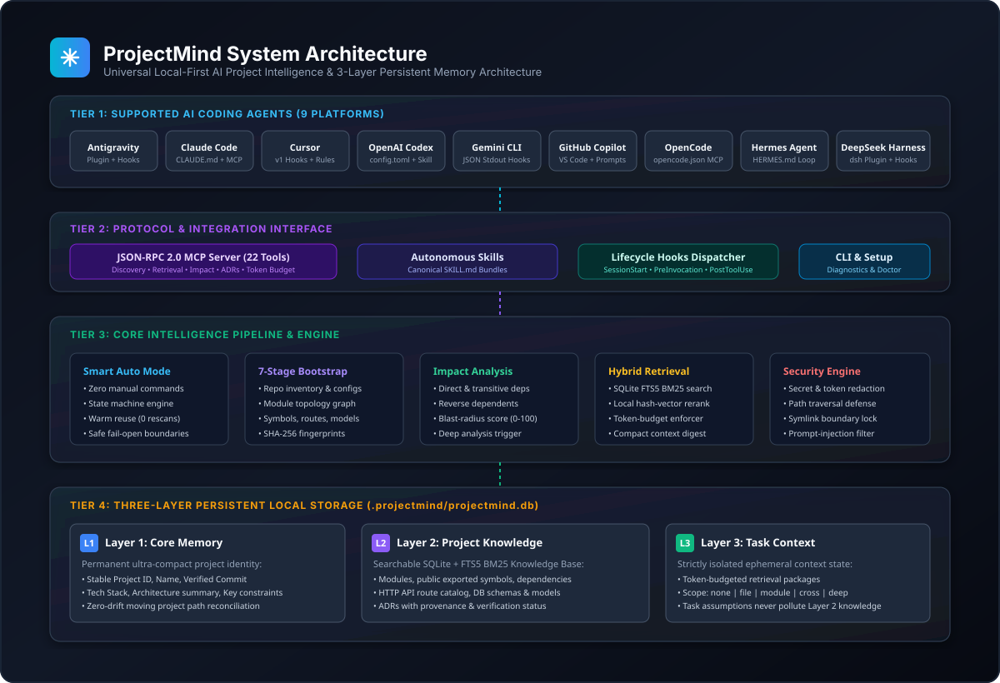
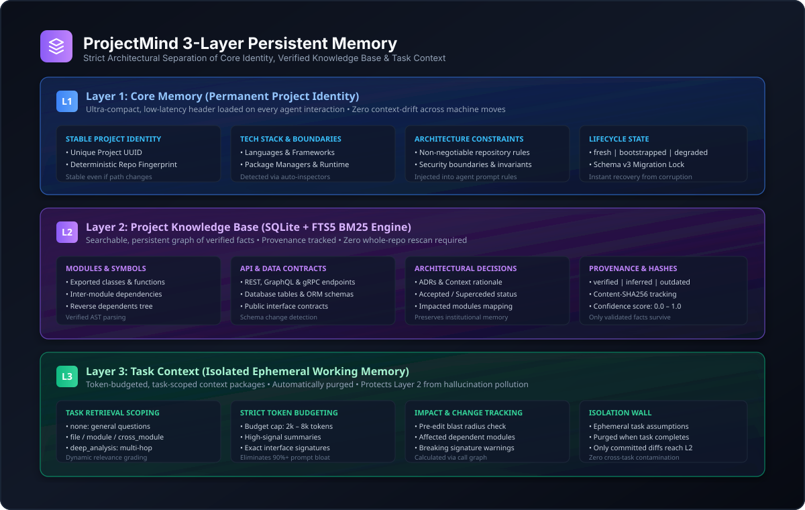
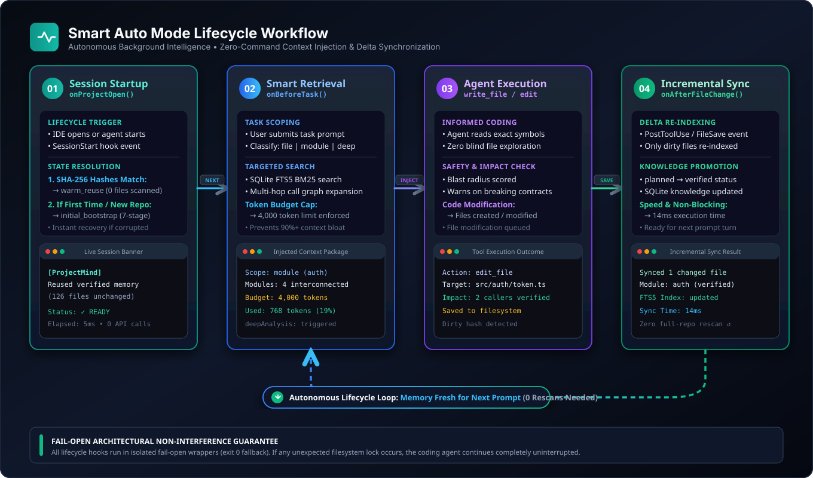
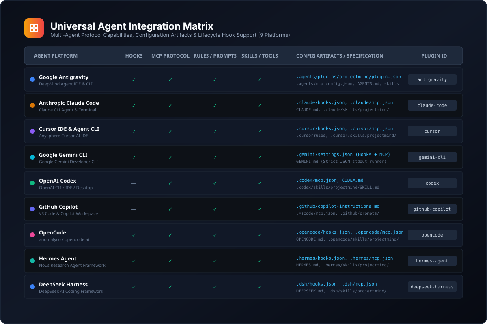
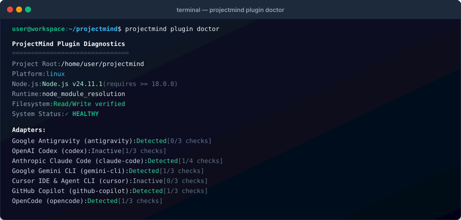
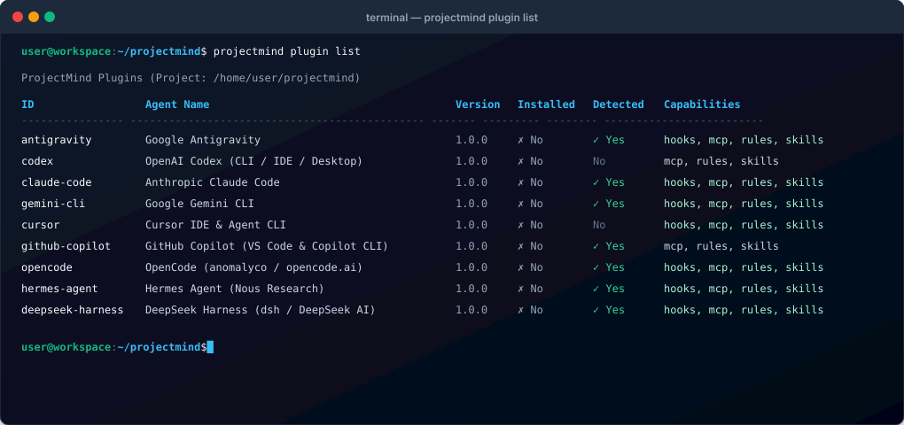
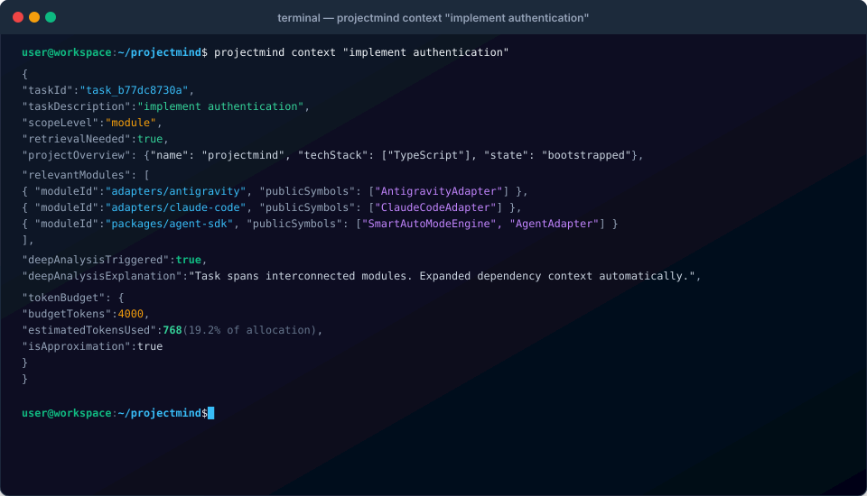
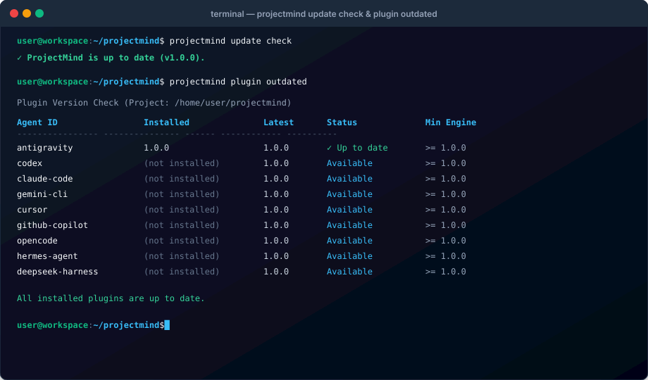

<p align="center">
  
</p>

<h1 align="center">ProjectMind</h1>
<p align="center"><b>Universal Local-First AI Project Intelligence &amp; Persistent 3-Layer Memory Engine</b></p>
<p align="center">
  <a href="https://github.com/Rootx202/ProjectMind/releases"></a>
  <a href="tests/"></a>
  <a href="#agent-compatibility-matrix"></a>
  <a href="SECURITY.md"></a>
  <a href="LICENSE"></a>
</p>

---

ProjectMind is a local-first, privacy-preserving project intelligence and persistent context engine that enables AI coding agents to understand, remember, and work with software repositories without repeatedly scanning the entire codebase.

ProjectMind is **not** a separate chatbot or code editor. It is an autonomous intelligence and persistent memory layer used directly by your existing coding agents:
**[Google Antigravity](https://antigravity.google/docs/mcp/)**, **[Anthropic Claude Code](https://code.claude.com/docs/en/hooks)**, **[Cursor](https://cursor.com/docs/hooks)**, **[Google Gemini CLI](https://geminicli.com/docs/tools/mcp-server/)**, **[OpenAI Codex](https://learn.chatgpt.com/docs/extend/mcp)**, **[GitHub Copilot in VS Code](https://code.visualstudio.com/docs/agents/reference/mcp-configuration)**, **[OpenCode](https://opencode.ai/docs/mcp)**, **[Hermes Agent](https://hermes-agent.nousresearch.com/docs/mcp)**, and **[DeepSeek Harness / Hermes](https://github.com/deepseek-ai/deepseek-harness)**.

---

## Table of Contents

- [Quick Start](#quick-start)
- [Prerequisites & System Requirements](#prerequisites--system-requirements)
- [Installation Guide](#installation-guide)
  - [Option A: One-Line Remote Installer (`curl | bash`)](#option-a-one-line-remote-installer-curl--bash)
  - [Option B: Local Repository Installation](#option-b-local-repository-installation)
  - [Windows Installation (PowerShell)](#windows-installation-powershell)
- [First Command After Installation](#first-command-after-installation)
- [Essential CLI Commands](#essential-cli-commands)
- [Troubleshooting & Diagnostics](#troubleshooting--diagnostics)
  - [Resolving `@projectmind/shared` / Missing Workspace Links](#resolving-projectmindshared--missing-workspace-links)
  - [Running Health Diagnostics](#running-health-diagnostics)
  - [Common Issues & Solutions](#common-issues--solutions)
- [Architecture & Visual Overview](#architecture--visual-overview)
  - [System Architecture](#system-architecture)
  - [3-Layer Persistent Memory Architecture](#3-layer-persistent-memory-architecture)
  - [Smart Auto Mode Lifecycle Workflow](#smart-auto-mode-lifecycle-workflow)
  - [Universal Agent Integration Matrix](#universal-agent-integration-matrix)
- [CLI Visual Walkthrough](#cli-visual-walkthrough)
- [Agent Compatibility Matrix](#agent-compatibility-matrix)
- [Key Capabilities](#key-capabilities)
- [The 27 MCP Intelligence Tools](#the-27-mcp-intelligence-tools)
- [What's New in v1.1.0](#whats-new-in-v110)
- [Monorepo Build & Test](#monorepo-build--test)
- [Documentation Guides](#documentation-guides)
- [License](#license)

---

## Quick Start

Get ProjectMind running on your system in under 60 seconds:

```bash
# 1. Install ProjectMind via the official installer
curl -fsSL https://raw.githubusercontent.com/Rootx202/ProjectMind/main/install.sh | bash

# 2. Ensure ~/.local/bin is in your PATH (if not already added)
export PATH="$HOME/.local/bin:$PATH"

# 3. Verify installation and inspect detected coding agents
projectmind plugin doctor

# 4. Install integration for your preferred agent (or install all 9 supported agents)
projectmind plugin install --all
```

Once installed, open any project in your coding agent (e.g. Antigravity, Claude Code, Cursor, Gemini CLI) and work normally. **Smart Auto Mode** automatically initializes project memory on first encounter, retrieves selective task-scoped context before coding, and synchronizes modified files after edits without requiring manual commands.

---

## Prerequisites & System Requirements

ProjectMind operates entirely on your local machine with zero external cloud dependencies.

| Requirement | Supported Versions | Notes |
| :--- | :--- | :--- |
| **Node.js** | `>= 18.0.0` (v18, v20, v22, v24 LTS verified) | Required for MCP server and CLI execution. |
| **npm** | `>= 8.0.0` (with native npm workspaces) | Required when building or installing from source. |
| **Operating System** | Linux (Ubuntu, Debian, Fedora, Arch, Alpine, etc.)<br/>macOS (Intel & Apple Silicon)<br/>Windows 10/11 (PowerShell 5.1+ / PowerShell 7+) | Cross-platform with POSIX and Windows-native installers. |
| **SQLite3 Engine** | Embedded SQLite 3 with FTS5 virtual tables | Bundled automatically via `@projectmind/storage`. |
| **Network** | 100% Offline by default | Network access is only used during explicit update checks. |

---

## Installation Guide

ProjectMind supports two primary installation methods on Linux & macOS, plus a dedicated Windows PowerShell installer.

### Option A: One-Line Remote Installer (`curl | bash`)

Best for users who want to install the ProjectMind CLI and agent integrations directly without cloning or managing the monorepo source:

```bash
curl -fsSL https://raw.githubusercontent.com/Rootx202/ProjectMind/main/install.sh | bash
```

**How it works:**
1. Runs safely via pipe without `BASH_SOURCE` unbound variable errors.
2. Installs runtime files into `~/.projectmind` (or custom `$PROJECTMIND_HOME`).
3. Generates the executable wrapper in `~/.local/bin/projectmind`.
4. Executes diagnostic verification (`projectmind plugin doctor`) before declaring success. If diagnostics fail, the installer exits with a non-zero code and reports the error immediately.

**Customizing remote installation:**
```bash
# Install integration for a specific agent directly
curl -fsSL https://raw.githubusercontent.com/Rootx202/ProjectMind/main/install.sh | bash -s -- --agent antigravity

# Install all 9 agent integrations during setup
curl -fsSL https://raw.githubusercontent.com/Rootx202/ProjectMind/main/install.sh | bash -s -- --all

# Custom installation directory
curl -fsSL https://raw.githubusercontent.com/Rootx202/ProjectMind/main/install.sh | bash -s -- --prefix /opt/projectmind --bin-dir /usr/local/bin
```

---

### Option B: Local Repository Installation

Best for contributors, developers modifying ProjectMind, or air-gapped environments:

```bash
# 1. Clone the repository
git clone https://github.com/Rootx202/ProjectMind.git
cd ProjectMind

# 2. Run the local installer
./install.sh
```

**How it works:**
1. Automatically detects that it is executing inside a local repository checkout.
2. Installs dependencies and links all internal `@projectmind/*` packages via npm workspaces.
3. Compiles TypeScript sources to JavaScript (`dist/`) and verifies all 13 internal packages are resolvable.
4. Creates a symlink wrapper `~/.local/bin/projectmind` pointing directly to `apps/cli/dist/index.js`.
5. Runs `projectmind plugin doctor` to verify environment health.

**Options for local installer:**
```bash
# Install integrations for all 9 agents
./install.sh --all

# Install integration for a single agent
./install.sh --agent claude-code

# Perform dry-run without writing files
./install.sh --dry-run
```

---

### Windows Installation (PowerShell)

For Windows 10, Windows 11, or Windows Server:

```powershell
# In PowerShell (run as regular user or Administrator):
.\install.ps1

# Or specify a target agent:
.\install.ps1 -Agent antigravity -All
```

The Windows installer automatically resolves directory boundaries, adds `%USERPROFILE%\.local\bin` to user PATH, and configures agent MCP settings with Windows path separators. See [WINDOWS.md](WINDOWS.md) for detailed Windows instructions.

---

## First Command After Installation

Immediately after installation, verify your environment and check agent integration health:

```bash
# 1. Verify system environment, Node.js version, and agent detection
projectmind plugin doctor
```

Sample output:
```
✓ Node.js Runtime: v20.19.5 (>= 18.0.0 supported)
✓ Filesystem Storage: ~/.projectmind (read/write verified)
✓ SQLite Engine: SQLite 3.46.1 with FTS5 virtual table support
✓ Workspace Linkage: All 13 internal @projectmind/* packages resolvable
✓ Agent Integrations: 9 supported (Google Antigravity, Claude Code, Cursor, Gemini CLI, etc.)
```

Next, view all supported coding agent integrations:
```bash
projectmind plugin list
```

To configure ProjectMind inside your current project repository:
```bash
cd /path/to/my-project
projectmind init
```
*(Or simply open your project in your coding agent — Smart Auto Mode initializes automatically!)*

---

## Essential CLI Commands

ProjectMind provides a unified CLI (`projectmind` or `node apps/cli/dist/index.js`):

| Goal | Command | Description |
| :--- | :--- | :--- |
| **System Diagnostics** | `projectmind plugin doctor` | Runs health check on Node.js, SQLite/FTS5, permissions, and agents. |
| **List Integrations** | `projectmind plugin list` | Displays status of all 9 supported agent plugins and adapters. |
| **Install Integration** | `projectmind plugin install <agent>` | Installs MCP server, skills, and hooks for `<agent>` (e.g. `antigravity`). |
| **Install All Agents** | `projectmind plugin install --all` | Configures integrations across all 9 supported coding environments. |
| **Verify Integration** | `projectmind plugin verify <agent>` | Inspects configuration files and validates schema integrity. |
| **Inspect Task Context** | `projectmind context --task "<text>"` | Displays token-budgeted context package that would be fed to the agent. |
| **Incremental Sync** | `projectmind sync` | Manually synchronizes modified files and updates affected modules. |
| **Storage Health** | `projectmind health` | Verifies SQLite integrity, event-chain hashes, and cache status. |
| **Event Log** | `projectmind memory events` | Inspects append-only hash-chained memory audit events. |
| **Check for Updates** | `projectmind update check` | Checks for ProjectMind core releases on GitHub. |
| **Plugin Outdated** | `projectmind plugin outdated` | Checks installed agent plugins against latest releases. |
| **Uninstall Integration**| `projectmind plugin uninstall <agent>`| Cleanly removes agent configuration while preserving project memory. |

---

## Troubleshooting & Diagnostics

### Resolving `@projectmind/shared` / Missing Workspace Links

**Symptom:**
```
Error: Cannot find module '@projectmind/shared'
or: npm workspace links are missing under node_modules/@projectmind
```

**Root Cause:**
This issue occurs in local repository checkouts when:
1. `npm install` was run before workspace definitions were synced, causing npm not to link `@projectmind/*` packages inside `node_modules/@projectmind/`.
2. The project was executed before running `node scripts/build.js`, so package entry points (`dist/index.js`) were not yet compiled.

**Permanent Fix:**
Run the following two commands from the root of the repository:

```bash
# 1. Link all internal workspace packages natively
npm install

# 2. Compile TypeScript sources and verify package resolution
node scripts/build.js
```

`scripts/build.js` includes an automated workspace symlink safeguard (`ensureWorkspaceLinks()`) and a post-build verification step that tests `require.resolve()` on all 13 `@projectmind/*` packages. The build will exit with an error code if any internal dependency cannot be resolved.

---

### Running Health Diagnostics

Whenever you encounter unexpected behavior, run the built-in doctor:

```bash
projectmind plugin doctor
```

To run diagnostics for a specific project folder:
```bash
projectmind plugin doctor --project-root /path/to/my-project
```

### Common Issues & Solutions

- **Agent does not show ProjectMind MCP tools after installation:**
  - *Solution:* Certain agents (such as Anthropic Claude Code, Google Gemini CLI, and OpenAI Codex) load MCP servers at startup. Restart your agent session or run `/mcp reload` inside the agent.
- **Lifecycle hooks do not fire in Cursor or Google Gemini CLI:**
  - *Solution:* Ensure your workspace is marked as **Trusted** in Cursor or Gemini CLI settings. Untrusted workspaces disable local lifecycle hooks for security reasons.
- **Corrupted SQLite Database:**
  - *Solution:* ProjectMind checks database integrity on every startup. If a file is corrupted, ProjectMind automatically moves the corrupted file to `.projectmind/backups/corrupted-<timestamp>.db.bak` and re-initializes a fresh database without losing Git history.
- **Moved Repository Folder:**
  - *Solution:* ProjectMind uses stable cryptographic project identifiers. If you move or rename a repository folder, ProjectMind automatically detects the move, updates `projectRoot`, and preserves all historical memory.

See [TROUBLESHOOTING.md](TROUBLESHOOTING.md) for more in-depth solutions.

---

## Architecture & Visual Overview

ProjectMind's modular architecture decouples high-level AI agent interaction from local persistent storage and selective retrieval.

### System Architecture
The 4-tier stack integrates coding agents via native hooks and MCP protocols into a unified core engine backed by local SQLite3 storage:
<p align="center">
  
</p>

### 3-Layer Persistent Memory Architecture
Memory is partitioned into three strictly isolated tiers to ensure ultra-fast bootstrapping, fact verification, and prevent hallucination contamination:
<p align="center">
  
</p>

| Memory Layer | SQLite Tables | Contents & Lifecycle |
| :--- | :--- | :--- |
| **Layer 1: Core Memory** | `core_memory`, `schema_migrations` | Permanent, ultra-compact project metadata: `projectId`, `projectName`, `projectRoot`, `previousRoots`, `mainTechStack`, `projectPurpose`, `keyConstraints`, `architecturalSummary`, `currentState`, `memorySchemaVersion`, and `lastVerifiedCommit`. |
| **Layer 2: Project Knowledge** | `project_files`, `file_chunks`, `project_modules`, `code_symbols`, `code_graph_edges`, `architectural_decisions`, `knowledge_items`, `knowledge_fts`, `memory_events`, `workspace_snapshots`, `index_manifest`, `vector_embeddings` | Structural records with full-file SHA-256 and chunk hashes, AST symbols, resolved import edges, modules, HTTP routes, DB models, ADRs, and an append-only hash-chained event log. `vector_embeddings` stores local feature-hash vectors; it is not a learned semantic index. |
| **Layer 3: Task Context** | `task_contexts`, `retrieval_cache`, `sync_events` | Ephemeral task-specific retrieval packages, token budget tracking, and snapshot-bound cache entries. Caches are keyed by workspace snapshot plus parser/retrieval/embedder versions and are never served after unsynchronized changes. |

### Smart Auto Mode Lifecycle Workflow
Continuous autonomous synchronization runs behind the scenes during normal development sessions without manual user commands:
<p align="center">
  
</p>

### Universal Agent Integration Matrix
Grounded adapter support for 9 distinct AI coding agent ecosystems across hooks, MCP servers, rules, and skills:
<p align="center">
  
</p>

---

## CLI Visual Walkthrough

The following captures demonstrate real terminal executions from ProjectMind running locally:

### 1. Diagnostics & Environment Health Check (`projectmind plugin doctor`)
Validates Node.js runtime, filesystem read/write permissions, and inspects detection status across all 9 agent platforms:
<p align="center">
  
</p>

### 2. Multi-Agent Ecosystem Status (`projectmind plugin list`)
Displays all 9 supported coding agent integrations, installed plugins, detected environments, and adapter capabilities:
<p align="center">
  
</p>

### 3. Selective Context Retrieval & Token Budgeting (`projectmind context`)
Demonstrates intelligent task scoping, module dependency multi-hop traversal, and token budget allocation (using only 768 tokens of a 4,000 token budget for multi-module tasks):
<p align="center">
  
</p>

### 4. Continuous Update Management (`projectmind update check` & `plugin outdated`)
Verifies Core engine updates and individual plugin versions directly against official GitHub Releases with SHA-256 integrity verification:
<p align="center">
  
</p>

---

## Agent Compatibility Matrix

All adapter implementations are grounded in official documentation for each coding environment:

| Coding Agent | Native Plugin | MCP Server | Agent Skills | Lifecycle Hooks | Automatic Invocation Mechanism | Restart Required | Official Documentation |
| :--- | :--- | :--- | :--- | :--- | :--- | :--- | :--- |
| **Google Antigravity** | Yes (`.agents/plugins/projectmind/plugin.json`) | Yes (`.agents/mcp_config.json`) | Yes (`.agents/skills/projectmind/SKILL.md`) | Yes (`SessionStart`, `PreInvocation`, `PostToolUse`, `Stop` in `hooks.json`) | Native Lifecycle Hooks + Autonomous Skill + MCP | No (`/mcp` or `/skills reload`) | [Antigravity MCP](https://antigravity.google/docs/mcp/), [Skills](https://antigravity.google/docs/skills/), [Plugins](https://antigravity.google/docs/build-plugins/) |
| **Anthropic Claude Code** | Yes (`.claude-plugin/plugin.json`) | Yes (`.mcp.json`) | Yes (`.claude/skills/projectmind/SKILL.md`) | Yes (`SessionStart`, `UserPromptSubmit`, `PostToolUse`, `Stop` in `.claude/settings.json`) | Native Lifecycle Hooks + Skill + `CLAUDE.md` + MCP | Yes (or `/mcp` & `/hooks`) | [Claude Code Settings](https://code.claude.com/docs/en/settings), [Hooks](https://code.claude.com/docs/en/hooks), [Skills](https://code.claude.com/docs/en/skills) |
| **Cursor** | No (uses `.cursor/` config) | Yes (`.cursor/mcp.json`) | Yes (`.agents/skills/projectmind/SKILL.md`) | Yes (`version: 1` in `.cursor/hooks.json`: `workspaceOpen`, `sessionStart`, `beforeSubmitPrompt`, `afterFileEdit`, `stop`) | Native Lifecycle Hooks + `.cursor/rules/projectmind.mdc` (`alwaysApply: true`) + MCP | No (auto-watched in trusted workspaces) | [Cursor MCP](https://cursor.com/docs/cli/mcp), [Hooks](https://cursor.com/docs/hooks), [Rules](https://cursor.com/docs/rules) |
| **Google Gemini CLI** | No (uses `.gemini/` config) | Yes (`.gemini/settings.json`) | Yes (`.agents/skills/projectmind/SKILL.md`) | Yes (`SessionStart`, `BeforeAgent`, `AfterTool`, `AfterAgent` in `.gemini/settings.json`) | Native Lifecycle Hooks (Strict JSON stdout) + Skill + `GEMINI.md` + MCP | Yes (or `/hooks` & `/settings`) | [Gemini CLI MCP](https://geminicli.com/docs/tools/mcp-server/), [Hooks](https://geminicli.com/docs/hooks/), [GEMINI.md](https://geminicli.com/docs/cli/gemini-md/) |
| **OpenAI Codex** | No (uses `.codex/config.toml`) | Yes (`[mcp_servers.projectmind]` in `.codex/config.toml`) | Yes (`.agents/skills/projectmind/SKILL.md`) | Limited (Cloud/Managed hooks restricted via `allow_managed_hooks_only`) | MCP `initialize` Server Instructions (<512 chars) + Skill + `AGENTS.md` | Yes (restart CLI or MCP server in IDE) | [Codex MCP](https://learn.chatgpt.com/docs/extend/mcp), [Config Reference](https://learn.chatgpt.com/docs/config-file/config-reference), [Codex Repo](https://github.com/openai/codex/blob/main/docs/config.md) |
| **GitHub Copilot (VS Code)** | No (uses `.vscode/` & `.github/`) | Yes (`.vscode/mcp.json` `servers` + `.mcp.json` `mcpServers`) | Yes (`.github/prompts/projectmind.prompt.md`) | No (No pre/post file edit shell hooks in standard local chat) | `.github/copilot-instructions.md` + MCP Tool Discovery (`chat.mcp.autostart`) | No (`MCP: List Servers` in Command Palette) | [VS Code MCP Config](https://code.visualstudio.com/docs/agents/reference/mcp-configuration), [Custom Instructions](https://code.visualstudio.com/docs/agent-customization/custom-instructions) |
| **OpenCode** | No (uses `opencode.json` & `.opencode/`) | Yes (`opencode.json` `mcp.projectmind` with `type: "local"`) | Yes (`.opencode/skills/projectmind/SKILL.md` + `.agents/`) | Yes (`.projectmind/hooks/opencode-hook.js`) | MCP Server + Skill + `AGENTS.md` Dynamic Reload | No (auto-reloads on file change) | [OpenCode MCP](https://opencode.ai/docs/mcp), [AGENTS.md](https://opencode.ai/docs/agents-md), [OpenCode Repo](https://github.com/anomalyco/opencode) |
| **Hermes Agent** | Yes (Native MCP Client + Skill Dir) | Yes (`.hermes/config.json` `mcp_servers` + `.hermes/mcp.json`) | Yes (`.hermes/skills/projectmind/SKILL.md` + `.agents/`) | Yes (`.projectmind/hooks/hermes-agent-hook.js`) | Native MCP + `HERMES.md` / `AGENTS.md` + Skill Loop | No (`hermes mcp list` or reload) | [Hermes Agent Docs](https://hermes-agent.nousresearch.com/docs/mcp), [Hermes Repo](https://github.com/NousResearch/hermes-agent) |
| **DeepSeek Harness** | Yes (`@projectmind/dsh-plugin` Profile Plugin) | Yes (`.dsh/mcp.json` + `.deepseek/mcp.json`) | Yes (`.dsh/skills/projectmind/SKILL.md` + `.agents/`) | Yes (`.projectmind/hooks/deepseek-harness-hook.js`) | MCP Server + Profile Plugin + `DEEPSEEK.md` + Skill | Yes (restart `dsh` or reload profile) | [DeepSeek Harness](https://github.com/deepseek-ai/deepseek-harness), [Superagent Prototype](https://github.com/deepseek-ai/dsh-superagent-prototype) |

---

## Key Capabilities

* **Zero-Command Daily Workflow (Smart Auto Mode)**: Once installed, the agent automatically initializes project memory on first encounter, retrieves selective task-scoped context before coding, and incrementally synchronizes modified files after edits.
* **7-Stage Controlled Bootstrap**: Analyzes project metadata, file inventory, entry points, architectural docs, module topology, symbols/routes/models, and SHA-256 fingerprints without blindly reading large or binary files or modifying source code.
* **Knowledge Reliability & Provenance**: Every record tracks `verificationStatus` (`verified`, `inferred`, `planned`, `unverified`, `outdated`), confidence score, source file references, and SHA-256 fingerprints. Inferences and planned prompt specifications are never presented as verified implementation facts.
* **Existing & Greenfield Project Support**: Supports indexing existing codebases and initializing brand-new projects from an initial prompt or specification (`mode: "prompt"`), automatically transitioning records from `planned` to `verified` as code is implemented.
* **Strict Local-First Security & Privacy**: Indexing, retrieval, and memory writes work 100% offline with zero mandatory cloud accounts or paid embedding APIs. Enforces secret exclusion (`.env`, `.pem`, `.key`, `.ssh`, tokens), path traversal and symlink escape protection, and prompt-injection sanitization.

---

## The 27 MCP Intelligence Tools

ProjectMind exposes 27 structured tools over standard JSON-RPC 2.0 stdio transport:

| Category | Tool Name | Purpose |
| :--- | :--- | :--- |
| **Project Discovery** | `initialize_project` | Runs 7-stage controlled bootstrap on an existing codebase or extracts `planned` knowledge from a new project prompt. |
| **Project Discovery** | `get_project_overview` | Returns Layer 1 Core Memory and high-level module summaries. |
| **Project Discovery** | `get_project_status` | Reports initialization state, schema version, entity counts, and pending file changes. |
| **Project Discovery** | `detect_project_changes` | Compares SHA-256 file fingerprints and Git status to detect added, modified, deleted, and renamed files. |
| **Context Retrieval** | `get_relevant_context` | Classifies task scope (`none`, `file`, `module`, `cross-module`, `deep-architecture`) and returns a token-budgeted context package. |
| **Context Retrieval** | `get_module_context` | Returns detailed module purpose, entry files, exported symbols, routes, models, dependencies, and ADRs. |
| **Context Retrieval** | `search_project_knowledge` | Executes hybrid retrieval: SQLite FTS5 BM25, AST symbol matching, code-graph neighbour expansion, and local feature-hash vector reranking (lexical, not learned embeddings). Returns per-hit explanations and path/line evidence. |
| **Context Retrieval** | `find_related_files` | Discovers files related by module membership, imports, or symbol references. |
| **Context Retrieval** | `get_file_summary` | Returns compact file metadata, role, SHA-256 hash, exported symbols, and imports without dumping raw source code. |
| **Context Retrieval** | `get_architecture_context` | Returns system-wide module dependency topology, API catalog, database models, and key constraints. |
| **Impact Analysis** | `analyze_change_impact` | Computes direct and transitive dependents, affected routes/models, risk level, and deep-analysis recommendations. |
| **Impact Analysis** | `find_dependencies` | Lists direct internal module dependencies, transitive dependencies, and external packages. |
| **Impact Analysis** | `find_dependents` | Lists all modules that directly or transitively depend on a target module or file. |
| **Impact Analysis** | `detect_affected_modules` | Maps changed file paths to directly and transitively affected modules. |
| **Memory Management** | `get_recent_changes` | Lists recent synchronization events and recent Layer 3 task context summaries. |
| **Memory Management** | `update_project_knowledge` | Upserts a Layer 2 knowledge item with explicit `verificationStatus` and source references. |
| **Memory Management** | `sync_changed_files` | Incrementally indexes modified/added/renamed/deleted files, updates affected modules, and transitions `planned` records to `verified`. |
| **Memory Management** | `record_architectural_decision` | Records a structured Architectural Decision Record (ADR) and invalidates affected module caches. |
| **Memory Management** | `get_project_decisions` | Retrieves ADRs and project constraints, optionally filtered by module. |
| **Context Efficiency** | `estimate_context_tokens` | Approximates token usage and calculates token savings of ProjectMind summaries vs. raw source files. |
| **Context Efficiency** | `get_compact_context` | Returns an ultra-compact (<800 token) project digest. |
| **Context Efficiency** | `get_context_manifest` | Returns the index manifest (snapshot id, parser/chunker/embedder versions), module fingerprints, and entity counts. |
| **Context Efficiency** | `get_health` | Reports SQLite integrity, append-only event-chain verification, cache stats, open conflicts, and the latest snapshot. |
| **Memory Integrity** | `get_memory_events` | Returns the append-only memory event log filtered by entity, namespace, or time. |
| **Memory Integrity** | `record_memory_event` | Appends a durable, attributed memory event with explicit namespace and visibility. |
| **Memory Integrity** | `get_memory_conflicts` | Lists optimistic-concurrency conflicts produced by concurrent writers. |
| **Memory Integrity** | `resolve_memory_conflict` | Merges or rejects a conflict proposal with an audit note. |

---

## What's New in v1.1.0

- **Resilient Multi-Mode Installer**: `install.sh` supports both piped execution (`curl | bash`) and local repository installations, with safe variable expansions, robust dependency linking, and non-zero exit codes on diagnostic failures.
- **Strict Workspace Linkage**: All internal packages declare mutual workspace dependencies, eliminating missing `@projectmind/shared` errors during offline local builds.
- **Snapshot-bound context**: Change detection runs before any retrieval cache lookup; caches are keyed by workspace tree hash plus parser/retrieval/embedder versions. Stale context is never returned.
- **Verified updates only**: Plugin artifacts are downloaded over HTTPS with mandatory SHA-256 checksums, extracted with traversal/symlink/size limits, validated against signed manifests, and rolled back on verification failure.
- **Real code structure**: `@babel/parser` AST extraction for TypeScript/JavaScript, resolving relative, workspace, and tsconfig path aliases into symbol tables and file-level code-graph edges.
- **Full-file integrity**: Streamed SHA-256 over entire files plus bounded chunk hashes, removing any prefix blind spots.
- **Shared memory foundation**: Append-only hash-chained `memory_events`, namespaces, actor identities, optimistic concurrency with conflict proposals, and bi-temporal validity (`asOf` retrieval).
- **Honest retrieval**: Hybrid FTS5 + AST symbols + code graph + local feature-hash reranking with per-hit explanations and path/line evidence.

---

## Monorepo Build & Test

For developers contributing to ProjectMind:

```bash
# 1. Install dependencies & link npm workspaces
npm install

# 2. Compile all packages, adapters, apps, and test suites
node scripts/build.js

# 3. Run the complete automated test suite (93/93 tests passing)
node scripts/test.js

# 4. Run the retrieval/freshness benchmark
node scripts/benchmark.js

# 5. Build verified release assets (core archive + 9 plugin bundles + SHA256SUMS)
node scripts/package-release.js
```

---

## Documentation Guides

- [**Installation Guide (INSTALL.md)**](INSTALL.md) — Comprehensive cross-platform installation instructions, options, and offline setups.
- [**Troubleshooting Guide (TROUBLESHOOTING.md)**](TROUBLESHOOTING.md) — Diagnostic workflows, recovery commands, backup restoration, and solutions for common issues.
- [**Security Architecture (SECURITY.md)**](SECURITY.md) — Local-first guarantees, secret exclusion engine, path traversal defense, and prompt injection mitigation.
- [**Linux Guide (LINUX.md)**](LINUX.md) — Linux distributions, XDG directory compliance, file descriptor tuning, and headless/systemd configurations.
- [**Windows Guide (WINDOWS.md)**](WINDOWS.md) — PowerShell setup, execution policies, path handling (drive letters, spaces, Unicode, UNC), and Windows Terminal.
- [**Marketplace Specification (MARKETPLACE.md)**](MARKETPLACE.md) — Distribution model, native agent marketplace integration, packaging, and catalog metadata.
- [**Plugin Development Guide (PLUGIN_DEVELOPMENT.md)**](PLUGIN_DEVELOPMENT.md) — Authoring new plugins, Plugin SDK APIs, lifecycle events, and testing.
- [**Release Engineering (RELEASE.md)**](RELEASE.md) — Release checklists, automated packaging, checksum verification, and publishing workflows.
- [**Implementation Status (docs/IMPLEMENTATION_STATUS.md)**](docs/IMPLEMENTATION_STATUS.md) — What is implemented and tested vs. experimental vs. planned, with known limits.
- [**Memory Model (docs/MEMORY_MODEL.md)**](docs/MEMORY_MODEL.md) — Namespaces, actors, append-only events, temporal validity, conflicts, and `asOf` retrieval.
- [**Repair & Verification Report (PROJECTMIND_REPAIR_REPORT.md)**](PROJECTMIND_REPAIR_REPORT.md) — Detailed audit report, fixes, and measurements.

---

## License

ProjectMind is open-source software licensed under the [MIT License](LICENSE).
